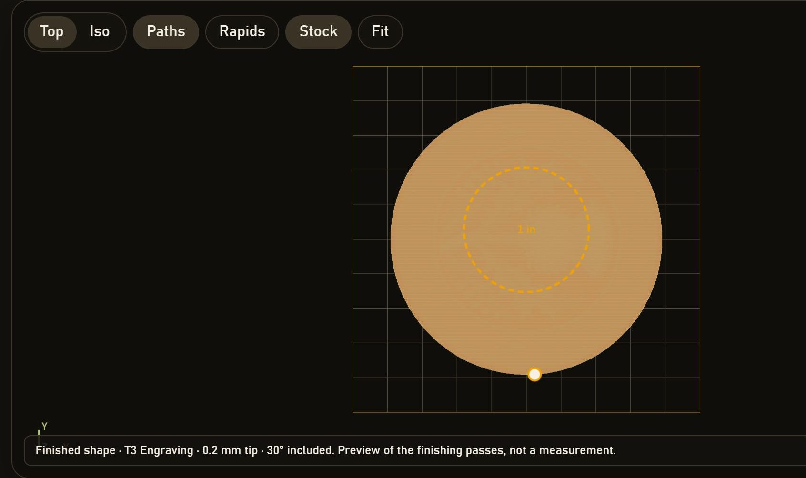
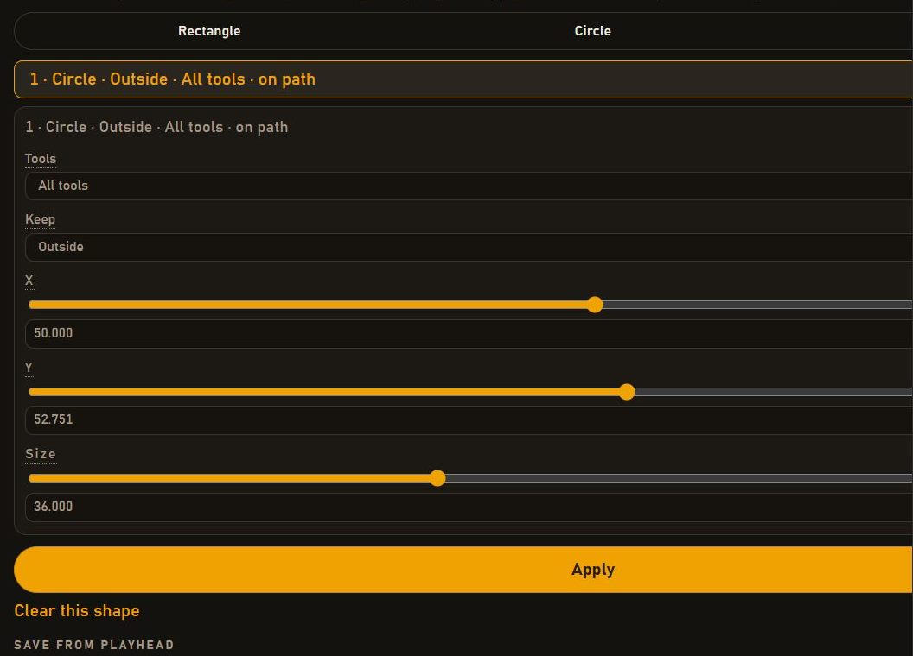
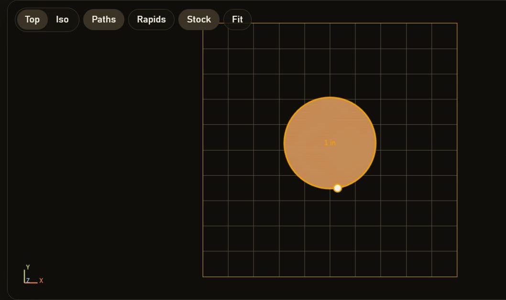
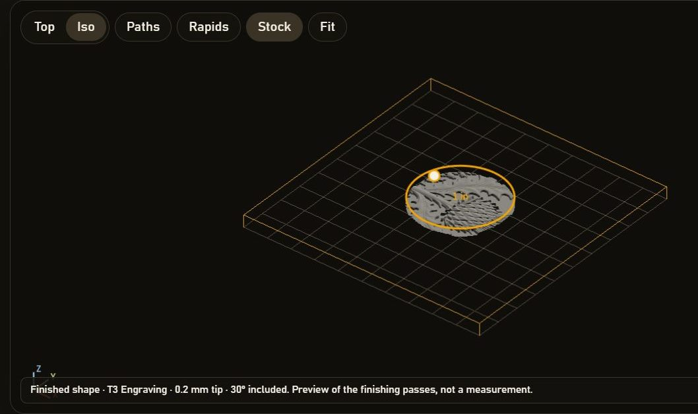
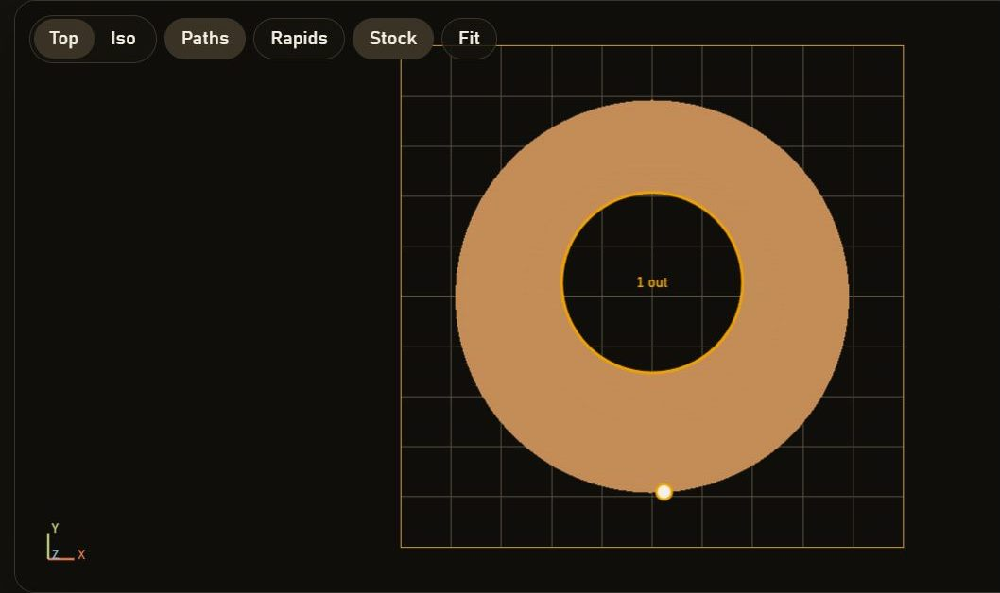
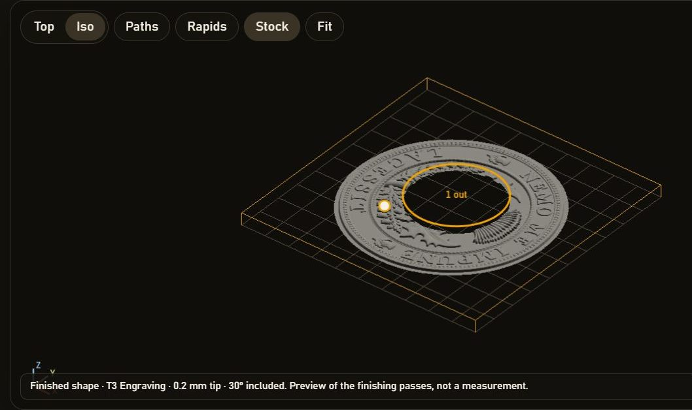
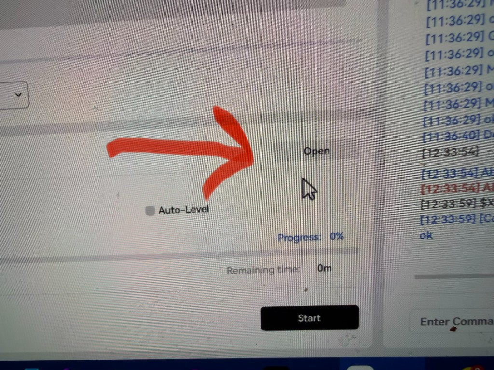
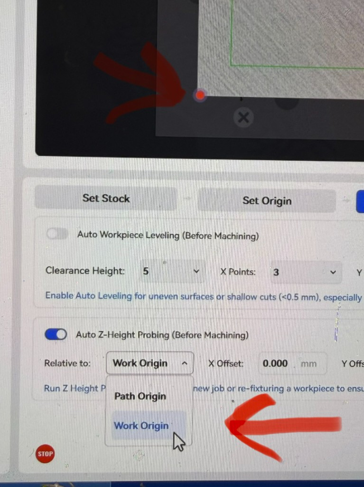

# Leny's Makera_NC Editor

**This is not a Makera product.** It is an independent project. Makera did not make it, does not endorse it, and does not support it.

**There are no guarantees.** This app is still in beta testing. A file it writes can be wrong. A wrong file can snap a bit, gouge the part, or damage the machine.

**Check the path on screen, and check the saved file, before you tool.**

**The author takes no responsibility for issues that arise from using this app. Use at your own risk.**

## Open it

Download or clone this folder, then double-click `index.html`. No install and no build step. The editor stays on your computer. It does not connect to the machine.

The full guide is `docs.html`. It starts with the same warning.

## What it does

Open any Makera Z1 `.nc` file and watch the cutter move through the job. The picture is there so you can see which tool is cutting, where it is on the plate, and whether a saved file still looks like the job you meant to run.

### Continue a job that stopped partway

A long relief can fail at 40%: a broken bit, a lost zero, or you simply stopped it. Scrub or play to that point and save. The file is named for the percent, such as `Makera_40_redo.NC`.

It is a restart, not a cut-off copy of the original. The file selects the tool that was in the spindle at that moment, starts the spindle, raises to clearance, travels across to that X and Y, feeds down, and then cuts the rest. Use it when the first part of a coin, a plate, or a 3D relief is already good and you only need the machine to pick up the unfinished part.

### Drill mounting holes

A plate often needs holes the original CAM file never had: four M3 screws in the corners, a 1/8 inch clearance hole, a through-hole for a wire. Place hole drops one on the plate. Each hole keeps its own size, depth, peck, feed, spindle, and tool number.

The size list includes ordinary drills and the pilot hole each common screw wants. M3 is a 2.5 mm hole. M6 is a 5 mm hole. 3.175 mm is a 1/8 inch drill. Peck lifts the bit to clear chips so a small drill is less likely to snap in a deep hole. Save drill file writes an NC you can run on its own, for a fixture plate, a lid, or a bracket blank.

### Thread those holes

The drill and the thread are two different bits. The drill makes a plain pilot. A thread mill, which is smaller, then spirals inside that hole and cuts the grooves. The Z1 spindle is not locked to the Z move, so this is a thread mill, not a tap.

A typical file is four M3 holes: T1 drills the 2.5 mm pilots, the machine stops, you put the thread mill in T2, and the file cuts the threads. The same screen covers M2 through M8 and the common inch screws, #4-40 through 1/4-20. Move a hole and its thread moves with it. Use it when a part needs screws and you do not want to tap by hand after the CNC is done.

### Recut one bad area, or leave one area alone

A finished surface can be spoiled in one spot: a chip-out in a corner, a patch of a relief that did not clean up, a logo you do not want to cut again. On the top view, with Paths on, draw a rectangle, a circle, or a polygon around that spot.

The shape is only a drawing until you press Apply. A draft is dashed. X and Y move the center, and Size is the width in millimeters. For a circle, size is the diameter. Changing Keep does not change the path until Apply is pressed again.

*A 36 mm circle on a coin relief. The dashed line is a draft. The path underneath is still the whole job.*

Inside keeps only the cuts in the shape, so you can recut that patch and leave the rest of the plate alone. Outside drops the cuts in the shape, so a region that is already good is left out of the new file. A line that crosses the edge is split, and the bit lifts to clearance between the pieces that remain. The patch does not mill a new outline. It keeps or drops cuts that are already in the file.

*Keep chooses Inside or Outside. Apply is the moment the path changes.*

*Inside. The cuts in the circle stay. Everything outside it is dropped.*

*Iso shows the finishing passes that remain. It is a preview, not a measurement.*

*The same circle, with Outside. The hole is left out. The rest of the path stays.*

*The rim and the lettering stay. The middle of the coin is left out of the new file.*

The job list is one row per toolpath, and the name usually includes the tool, such as `[T2] finishing`. Check only that finishing row, set Tools to Checked tools, and the roughing tool stays whole. Or leave Tools on All tools, as these pictures do, and the shape applies to the whole job. Clear this shape takes that shape back out. A shape that would remove every cut is refused. After Apply, save from the playhead writes the path on screen. Use it when rerunning a two-hour file to fix a thumbnail-sized flaw would be a waste of the bit.

### See a flat relief

A 3D relief with a finishing pass opens in the 3D view as a shaded solid of those finishing passes. Roughing and an outline cut stay out of the picture, so you see the finished face. Paths turns the cut lines on. Rapids turns the fast travel on. The flat Top view is the lines, which is where a patch is drawn.

Play, or move the slider, and each stretch the bit has already run drops away. The solid stays. The buttons on the right jump to Top, Front, Right, Back, Left, and Bottom, and you can drag from any of those to keep turning. The caption names the tool. It is a preview, not a measurement.

### Watch a 4th-axis carve

A rotary job spins the blank on a lathe inside the machine while the bit stays above it and moves in X, Y, and Z. Open the file and the view shows the round stock, with the path wrapped on the wood. Press play and the wood turns under the bit. Path the bit has already run drops away. The last pass is drawn as a solid that follows the tip of that pass, using the tip size from the file, so at the end of the preview you see the surface the bit left. Scales, grooves, and thin fins stay where the bit put them. The caption names the tool. It is a preview, not a measurement.

*At the end of the preview the last pass is a solid. The caption names the tool and the tip. It is a picture of that pass, not a measurement.*

*Zoom in and the surface follows the tip. Scales, feathers, and thin vanes stay where the bit put them.*

This picture does not change the rotary settings. Saving at 0% writes the original program. A redo from later in the file looks backward to the last lifted end of the X travel, the axis along the shaft, and starts there. The percent in the name can be earlier than where you parked. The angle is set at clearance before the bit feeds down. A finish that never returns to an end of X is cut again from the beginning of that finish, using the angle reset already in the file, so the rotary is not sent back through the whole running total. Watch that start before you tool.

The saved file can still contain a machine line that says Makera Z1. That line is there so the controller accepts the file. It does not mean Makera made this editor.

### Open that file in Makera Studio

This editor writes the file. Makera Studio is what runs it. Press Open and choose the file you just saved.

Before you press Start, turn on Auto Z-Height Probing and set Relative to Work Origin. Set the height only. An edited file may already have removed material, so a height read anywhere else, including the path origin, is taken on a surface the file no longer expects. That wrong height can drive the bit into the work.

